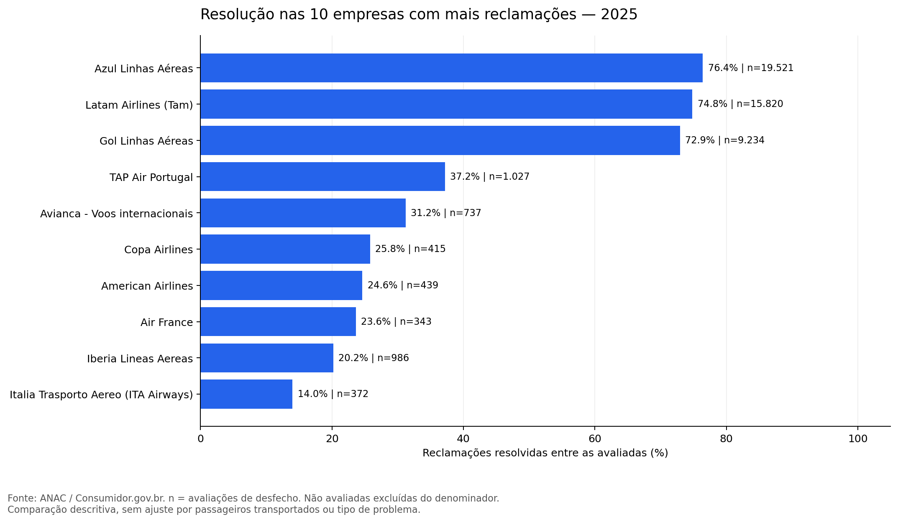
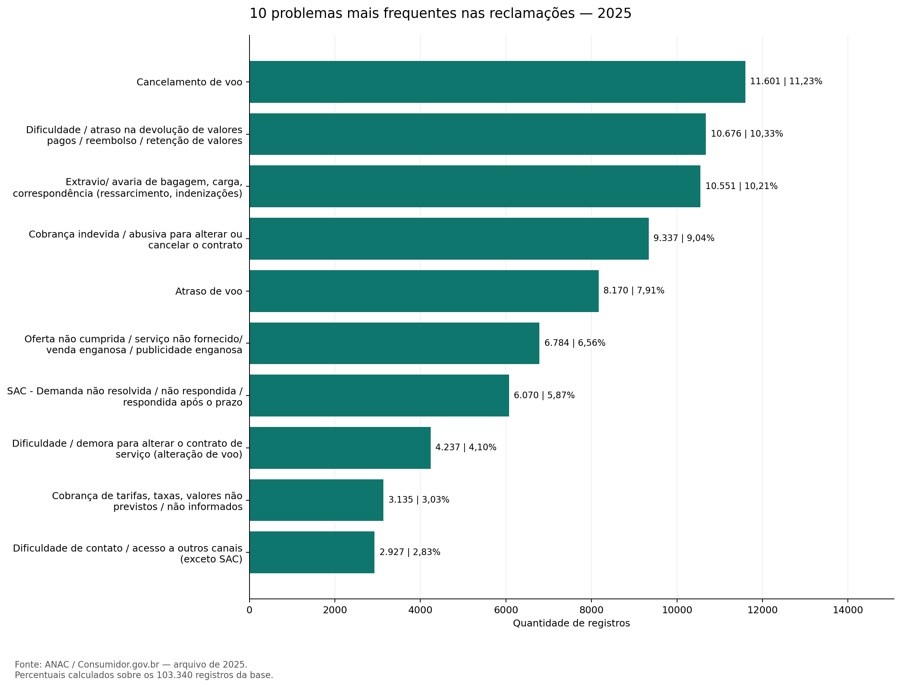
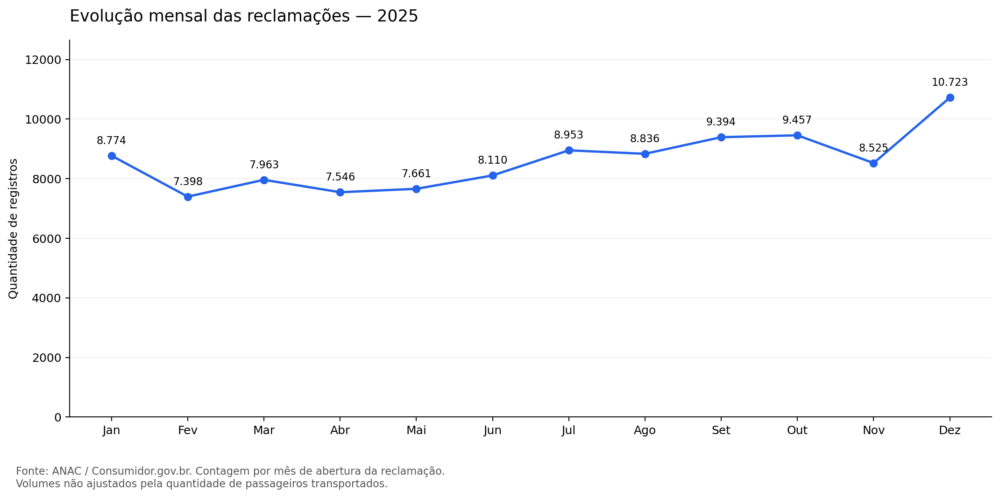

# Reclamações de passageiros | Python e Pandas

Análise de 103.340 registros de reclamações de 2025 disponibilizados pela ANAC a partir do Consumidor.gov.br. O objetivo é identificar assuntos prioritários para investigação e comparar indicadores de atendimento com seus respectivos denominadores.

**Tecnologias:** Python · Pandas · Matplotlib · Google Colab

## Resultados

| Indicador | Resultado | Base do cálculo |
|---|---:|---|
| Respondidas | 99,09% | 102.402 de 103.340 registros |
| Resolução entre avaliadas | 67,99% | 35.394 de 52.055 avaliações de desfecho |
| Cobertura da avaliação | 50,37% | 52.055 de 103.340 registros |
| Nota média | 3,56 / 5 | 52.055 notas preenchidas |
| Tempo médio / mediana | 5,80 / 7 dias | 102.183 tempos preenchidos e não negativos |

Cancelamento de voo, problemas de reembolso e extravio/avaria de bagagem, carga ou correspondência concentram **31,77%** dos registros. Esses assuntos são candidatos a uma investigação operacional; não estimamos ganhos ou redução de reclamações.

Dezembro teve o maior volume, **10.723 registros**, com aumento de **25,78%** sobre novembro. A base não permite atribuir a causa a férias, demanda ou piora do serviço.

## Visualizações

Entre as dez empresas com mais registros, Azul, Latam e Gol apresentaram, respectivamente, 76,40%, 74,82% e 72,95% de resolução entre avaliações de desfecho. Coberturas de avaliação variam: não se trata de um ranking geral de qualidade.

## Base e reprodução

- [Fonte oficial e arquivos anuais](https://sistemas.anac.gov.br/dadosabertos/Voos%20e%20opera%C3%A7%C3%B5es%20a%C3%A9reas/Dados%20do%20consumidor.gov/)
- Arquivo: `dadosconsumidor2025.csv`, atualizado em 01/10/2026, obtido em 11/10/2026.
- [Dicionário publicado pela ANAC](https://www.anac.gov.br/acesso-a-informacao/dados-abertos/areas-de-atuacao/voos-e-operacoes-aereas/dados-do-consumidor-gov/52-dados-do-consumidor-gov). A estrutura atual tem 28 colunas; os nomes foram conferidos no CSV.
- A primeira linha contém a atualização e é ignorada com `skiprows=1`; separador `;`, codificação `utf-8-sig`.
- A versão usada está identificada em `dados_sha256.txt`. Revisões futuras da fonte podem mudar os resultados.

1. Baixe o CSV oficial de 2025.
2. Abra `analise_reclamacoes_aereas.ipynb` no Google Colab e execute todas as células, em ordem. Quando solicitado, envie o CSV.
3. Localmente, instale as dependências de `requirements.txt`, abra o notebook em um ambiente Jupyter e mantenha o CSV ao lado dele.
4. A execução gera as pastas `graficos/` e `resultados/`.

O notebook inclui códigos, saídas e interpretação. As tabelas completas por empresa, problema e mês estão em `resultados/`.

## Decisões de tratamento e limitações

- Todas as linhas foram mantidas. Há 10 repetições exatas além da primeira ocorrência, mas não há identificador único para confirmar duplicidade de reclamações.
- 219 tempos negativos são desconsiderados somente nos cálculos de duração. 938 tempos ausentes não foram preenchidos com zero. Valores altos positivos foram mantidos; sua validade individual não foi comprovada.
- Usamos o tempo informado pela fonte, que desconta o período de análise do gestor, quando aplicável; não recalculamos como diferença simples entre datas.
- A taxa de resolução usa somente `Resolvida` e `Não Resolvida`; não avaliadas não são tratadas como resolvidas. Este é um indicador do projeto, não uma reprodução declarada do índice oficial.
- 49,63% dos registros não têm nota. Avaliações voluntárias podem diferir dos casos não avaliados.
- Há divergência entre os totais de situação `Finalizada avaliada` (52.058) e desfecho explícito (52.055). O notebook apresenta o cruzamento; cada indicador usa seu campo específico.
- Reclamações na plataforma não representam todos os passageiros. Não há ajuste por volume de passageiros, rotas ou tipos de problema.
- Um ano de dados não demonstra sazonalidade nem permite estabelecer causas.

## Próximos passos

Comparar resolução dentro de cada tipo de problema; investigar os tempos negativos na fonte; incorporar passageiros transportados e outros anos para ampliar as comparações.
